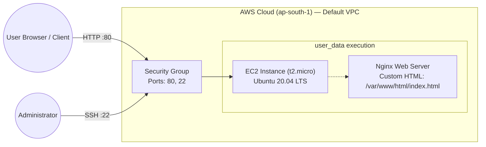

# EC2 Nginx Deployment with Terraform

[](https://www.terraform.io/)
[](https://aws.amazon.com/)
[](https://ubuntu.com/)
[](https://nginx.org/)

---

## 👤 Student & Assignment Information

- **Student Name:** Kaushal Patil
- **HeroVired Student ID:** Kaushal Patil_13408
- **Email ID:** patilkaushal89@gmail.com
- **Assignment Title:** EC2 Nginx Deployment with Terraform (DevOps Skills Test 3 Reattempt)
- **Repository Name:** `Nginx-Deployment-through-Terraform`

---

## 📋 Project Overview

This project demonstrates Infrastructure as Code (IaC) principles using **Terraform** to provision and manage AWS cloud resources. An **AWS EC2 instance (`t2.micro`)** running **Ubuntu 20.04 LTS** is deployed inside the **AWS Default VPC**, configured with a dedicated **Security Group**, and automatically bootstrapped using cloud-init **`user_data`** to install and serve a custom **Nginx** web page.

### Key Highlights:
- **No Unnecessary Resource Creation:** Uses the existing AWS Default VPC directly (`data "aws_vpc" "default"`). No custom VPCs, subnets, or internet gateways are created, fully aligning with task constraints.
- **Automated Bootstrapping:** Installs Nginx and replaces the default index page with the required text:
  > `"Welcome to the Terraform-managed Nginx Server on Ubuntu"`
- **Security Group Hardening:** Restricts inbound access to Port 80 (HTTP) and Port 22 (SSH).
- **Clean Output & Teardown:** Automatically outputs the instance Public IPv4 address upon deployment and supports 1-step teardown via `terraform destroy`.

---

## 📐 Architecture Diagram



---

## 📂 Repository File Structure

```text
Nginx-Deployment-through-Terraform/
├── main.tf          # Core Terraform configuration (Provider, Default VPC query, SG, EC2, user_data)
├── variables.tf     # Configurable variables (Region, instance type, project name, key pair)
├── outputs.tf       # Exported outputs (Public IP, Instance ID, Web URL)
├── .gitignore       # Git ignore rules for Terraform states, lock files, and sensitive data
├── screenshots/     # Verifiable step-by-step evidence screenshots
└── README.md        # Complete project documentation and execution guide
```

---

## 🛠️ Brief Explanation of Resources Created

1. **`data "aws_vpc" "default"`**: Queries the existing AWS Default VPC in the configured region (`ap-south-1`). This avoids creating unnecessary networking overhead.
2. **`data "aws_ami" "ubuntu_20_04"`**: Dynamically queries the latest official Canonical Ubuntu 20.04 LTS AMI (`ubuntu/images/hvm-ssd/ubuntu-focal-20.04-amd64-server-*`).
3. **`resource "aws_security_group" "nginx_sg"`**:
   - Inbound HTTP on port `80` (public access from `0.0.0.0/0`).
   - Inbound SSH on port `22` (remote administration from `0.0.0.0/0`).
   - Outbound egress allowing all traffic (`-1`).
4. **`resource "aws_instance" "nginx_server"`**:
   - Instance type: `t2.micro`.
   - OS: Ubuntu 20.04 LTS.
   - Public IP auto-assignment enabled.
   - `user_data` script: Updates `apt`, installs `nginx`, enables systemd service, writes the custom HTML page, and restarts Nginx.
5. **`output "public_ip"`**: Prints the assigned public IPv4 address upon completion.

---

## 🚀 Step-by-Step Execution Guide

### 1. Initialize Terraform
Initializes the working directory and downloads the HashiCorp AWS provider plugin:
```bash
terraform init
```

### 2. Validate Configuration
Checks configuration files for syntactic validity and internal consistency:
```bash
terraform validate
```

### 3. Review Execution Plan
Generates and previews the declarative execution plan showing resources to be provisioned:
```bash
terraform plan
```

### 4. Apply Configuration (Provision Infrastructure)
Provisions the security group and EC2 instance on AWS:
```bash
terraform apply -auto-approve
```
Upon completion, Terraform will output:
```text
Outputs:

instance_id = "i-xxxxxxxxxxxxxxxxx"
nginx_url = "http://<PUBLIC_IP>"
public_ip = "<PUBLIC_IP>"
```

### 5. Verify the Deployed Nginx Web Server
Wait ~1-2 minutes for cloud-init `user_data` to complete installation, then test:
```bash
# Terminal curl verification
curl http://<PUBLIC_IP>

# Or open in your browser
open http://<PUBLIC_IP>
```

---

## 📸 Screenshots & Evidence

Evidence screenshots verifying all phases of execution are stored in the [`screenshots/`](screenshots/) directory:

| # | Screenshot File | Description |
|---|---|---|
| **01** | `screenshots/01-terraform-init-validate.png` | Terminal output of `terraform init` and `terraform validate` passing. |
| **02** | `screenshots/02-terraform-plan.png` | `terraform plan` execution previewing the resources to be created. |
| **03** | `screenshots/03-terraform-apply.png` | Terminal output of `terraform apply` showing resource creation and `public_ip` output. |
| **04** | `screenshots/04-aws-ec2-running.png` | AWS Management Console showing the running `t2.micro` EC2 instance in the default VPC. |
| **05** | `screenshots/05-aws-security-group.png` | AWS Management Console showing the Security Group inbound rules for Port 80 and Port 22. |
| **06** | `screenshots/06-nginx-browser-live.png` | Web browser visiting `http://<PUBLIC_IP>` displaying: *"Welcome to the Terraform-managed Nginx Server on Ubuntu"*. |

---

## 🧹 Infrastructure Teardown (Clean Resource Deletion)

To delete all AWS resources created by this Terraform configuration and prevent ongoing AWS charges:

```bash
terraform destroy -auto-approve
```
