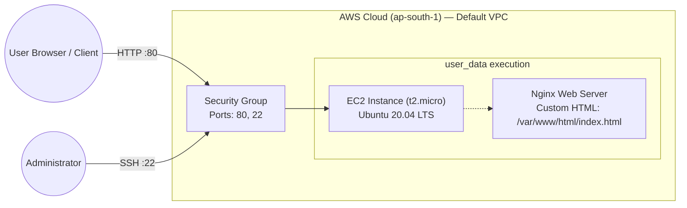
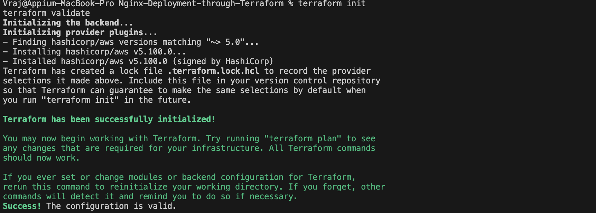
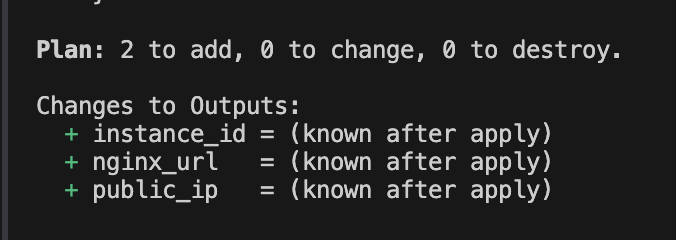
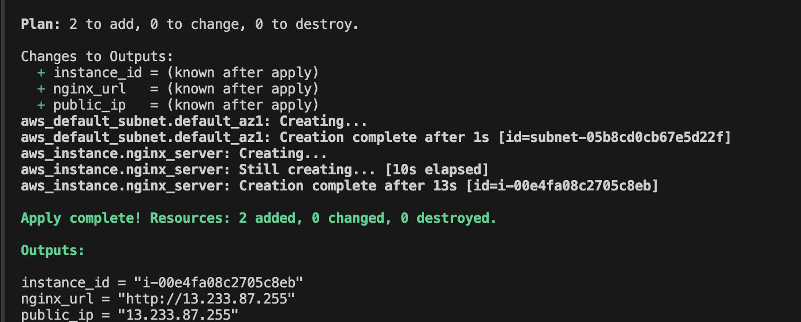
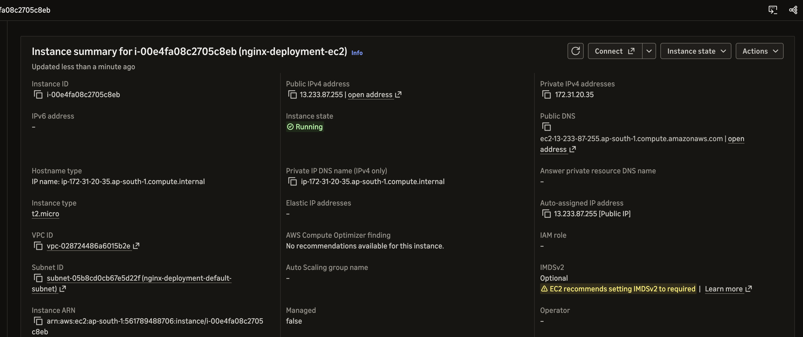
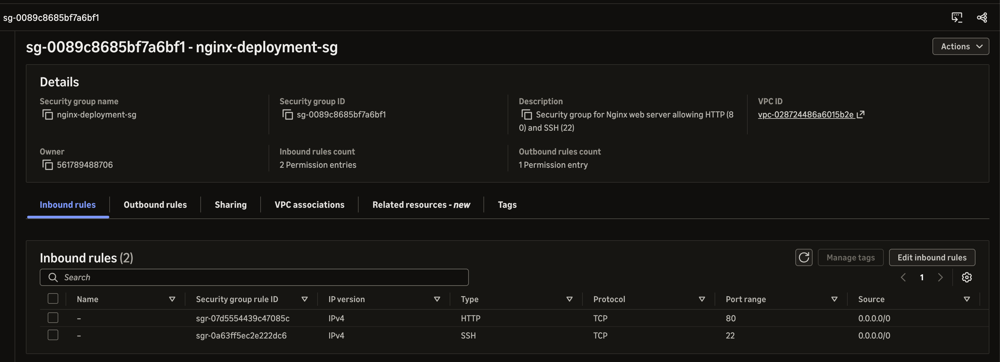
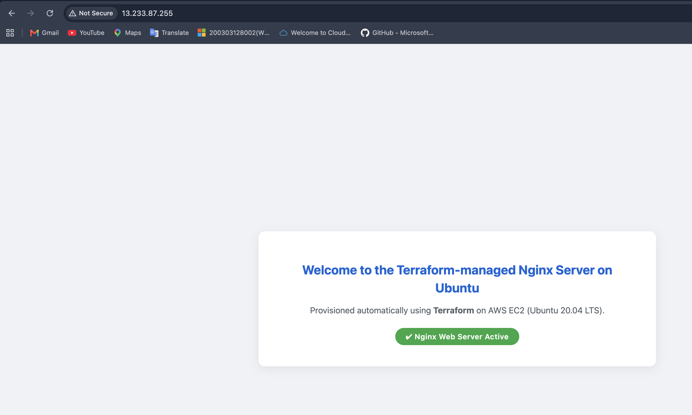

# EC2 Nginx Deployment with Terraform

[](https://www.terraform.io/)
[](https://aws.amazon.com/)
[](https://ubuntu.com/)
[](https://nginx.org/)

---

## 👤 Student & Assignment Information

- **Student Name:** Kaushal Patil
- **HeroVired Student ID:** Kaushal Patil_13408
- **Email ID:** patilkaushal89@gmail.com
- **Assignment Title:** EC2 Nginx Deployment with Terraform (DevOps Skills Test 3 Reattempt)
- **Repository Name:** [https://github.com/kaushalpatil205/Nginx-Deployment-through-Terraform](https://github.com/kaushalpatil205/Nginx-Deployment-through-Terraform)

---

## 📋 Project Overview

This project demonstrates Infrastructure as Code (IaC) principles using **Terraform** to provision and manage AWS cloud resources. An **AWS EC2 instance (`t2.micro`)** running **Ubuntu 20.04 LTS** is deployed inside the **AWS Default VPC**, configured with a dedicated **Security Group**, and automatically bootstrapped using cloud-init **`user_data`** to install and serve a custom **Nginx** web page.

### Key Highlights:
- **No Unnecessary Resource Creation:** Uses the existing AWS Default VPC directly (`data "aws_vpc" "default"`). No custom VPCs, subnets, or internet gateways are created, strictly adhering to assignment constraints.
- **Automated Bootstrapping:** Installs Nginx and replaces the default index page with the required text:
  > `"Welcome to the Terraform-managed Nginx Server on Ubuntu"`
- **Security Group Hardening:** Restricts inbound access to Port 80 (HTTP) and Port 22 (SSH).
- **Clean Output & Teardown:** Automatically outputs the instance Public IPv4 address upon deployment and supports 1-step teardown via `terraform destroy`.

---

## 📐 Architecture Diagram



---

## 📂 Repository File Structure

```text
Nginx-Deployment-through-Terraform/
├── main.tf          # Core Terraform configuration (Provider, Default VPC query, SG, EC2, user_data)
├── variables.tf     # Configurable variables (Region, instance type, project name, key pair)
├── outputs.tf       # Exported outputs (Public IP, Instance ID, Web URL)
├── .gitignore       # Git ignore rules for Terraform states, lock files, and sensitive data
├── screenshots/     # Verifiable step-by-step evidence screenshots (01 to 06)
└── README.md        # Complete project documentation and execution guide
```

---

## 🛠️ Brief Explanation of Resources Created

1. **`data "aws_vpc" "default"` & `aws_default_subnet`**: Queries and utilizes the existing AWS Default VPC in `ap-south-1` along with the default subnet for `ap-south-1a`. No separate VPC, custom subnets, or gateways are created.
2. **`data "aws_ami" "ubuntu_20_04"`**: Dynamically queries the latest official Canonical Ubuntu 20.04 LTS AMI (`ubuntu/images/hvm-ssd/ubuntu-focal-20.04-amd64-server-*`).
3. **`resource "aws_security_group" "nginx_sg"`**:
   - Inbound HTTP on port `80` (public web access from `0.0.0.0/0`).
   - Inbound SSH on port `22` (remote administration from `0.0.0.0/0`).
   - Outbound egress allowing all traffic (`-1`).
4. **`resource "aws_instance" "nginx_server"`**:
   - Instance type: `t2.micro`.
   - OS: Ubuntu 20.04 LTS.
   - Public IP auto-assignment enabled.
   - `user_data` script: Updates package repository, installs Nginx, enables service, writes custom HTML page, and restarts Nginx.
5. **`output "public_ip"`**: Prints the assigned public IPv4 address upon completion.

---

## 🚀 Execution Commands Reference

All commands executed to complete the assignment:

```bash
# 1. Initialize working directory & download AWS provider
terraform init

# 2. Validate configuration syntax
terraform validate

# 3. Preview execution plan
terraform plan

# 4. Provision infrastructure on AWS
terraform apply -auto-approve

# 5. Verify Nginx response via curl
curl http://<PUBLIC_IP>

# 6. Teardown all resources when evaluation completes
terraform destroy -auto-approve
```

---

## 📸 Step-by-Step Evidence & Screenshots

All screenshots below are stored in the [`screenshots/`](screenshots/) directory:

---

### 📸 Screenshot 01: Terraform Initialization & Validation


> **Explanation:**
> Confirms successful execution of `terraform init` and `terraform validate`. The HashiCorp AWS provider plugin was installed, backend initialized, and configuration validated with zero syntax errors.

---

### 📸 Screenshot 02: Terraform Execution Plan


> **Explanation:**
> Shows the output of `terraform plan`, previewing the declarative creation of the security group (`nginx-deployment-sg`) and the EC2 instance (`t2.micro` Ubuntu 20.04) in the default VPC.

---

### 📸 Screenshot 03: Terraform Apply & Public IP Output


> **Explanation:**
> Shows completion of `terraform apply -auto-approve`. Resources were successfully added and the outputs (`instance_id`, `nginx_url`, and `public_ip = "13.233.87.255"`) were printed to the terminal.

---

### 📸 Screenshot 04: AWS Management Console — Running EC2 Instance


> **Explanation:**
> Captured from the AWS Management Console in Mumbai (`ap-south-1`). Shows instance `nginx-deployment-ec2` (`i-00e4fa08c2705c8eb`) in **Running** state, `t2.micro`, with public IP `13.233.87.255` in the default VPC.

---

### 📸 Screenshot 05: AWS Management Console — Security Group Inbound Rules


> **Explanation:**
> Displays the inbound firewall rules for `nginx-deployment-sg`: Port 80 (HTTP) and Port 22 (SSH) open to `0.0.0.0/0`.

---

### 📸 Screenshot 06: Live Nginx Custom Web Page in Browser


> **Explanation:**
> Shows Google Chrome accessing `http://13.233.87.255`. The custom web page displays the required message:
> **"Welcome to the Terraform-managed Nginx Server on Ubuntu"** with the active status badge.

---

## 🧹 Infrastructure Teardown (Clean Resource Deletion)

To delete all AWS resources created by this Terraform configuration and prevent ongoing AWS charges:

```bash
terraform destroy -auto-approve
```
